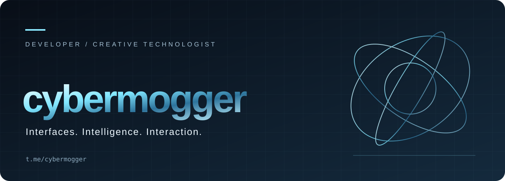
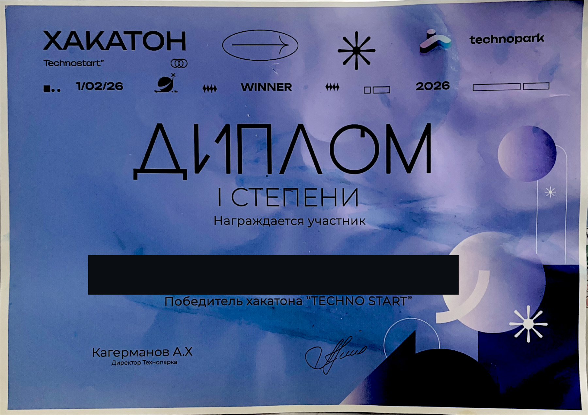
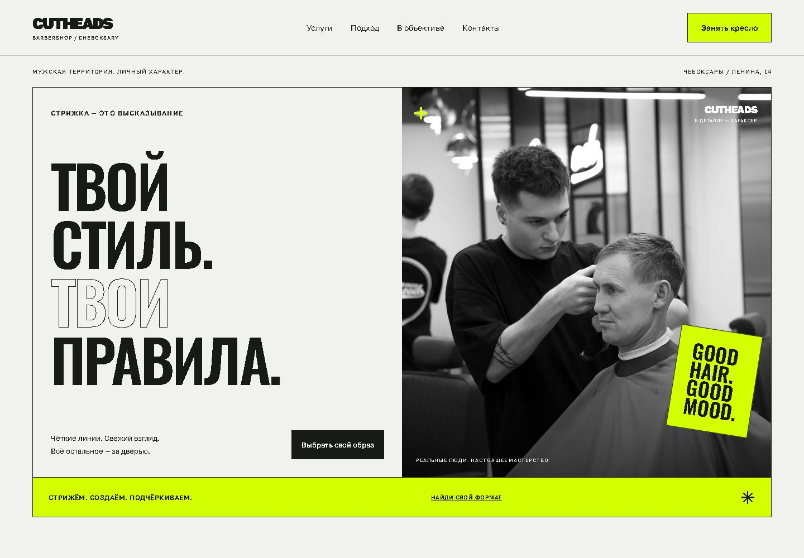

  

  <a href="#избранные-проекты">Проекты</a> &nbsp; / &nbsp;
  <a href="#технологии">Технологии</a> &nbsp; / &nbsp;
  <a href="https://github.com/liquidsss?tab=repositories">Репозитории</a>

<h1 align="center">Идеи, которые можно запустить.</h1>

Интерактивные интерфейсы, компьютерное зрение, 3D и аналитические системы. Мои и совместные проекты — от музейных экспонатов до инструментов работы с данными.

---

## Победы

### 🏆 Техностарт · 2026 · TerraWatch AI

**Диплом I степени — победитель хакатона TECHNO START.**

Победивший проект анализирует спутниковые изображения Земли и выявляет аномалии и изменения: вырубку леса, свалки и пожары. Сравнение снимков «до / после» помогает находить участки, требующие внимания.

`Python` · `Flask` · `OpenCV` · `PostgreSQL / PostGIS`

Исходный код — в закрытом командном репозитории.

[Открыть оригинал диплома (PDF)](certificates/technostart-2026-redacted.pdf)

---

## Избранные проекты

### Портал времени
**Историю можно исследовать движением руки.**

**Коммерческий результат: проект продан Чеченскому государственному университету (ЧГУ).**

Музейный интерфейс сравнения прошлого и настоящего: щипок открывает шторку между исторической и современной фотографиями, движение двух рук переключает места. Управление работает через камеру; мышь и клавиатура дают резервный способ взаимодействия.

В проекте предусмотрены локальная модель трекинга, настройка чувствительности жестов, возврат на старт при простое и повторное подключение камеры. Отдельная версия «Живая история ЧГУ» исследует карту мест и историческую ленту.

`JavaScript` · `MediaPipe Hands` · `Computer Vision` · `HTML / CSS`

[Основной репозиторий](https://github.com/Ne0ne1/museum) · [Моя версия](https://github.com/liquidsss/museum)

 

### Наследие в коде
**Архитектура, которую можно разобрать и собрать заново.**

Интерактивный 3D-экспонат со стилизованной вайнахской башней для конкурса «Здесь моя Родина». Вращение камеры, разбор на части, поэтапная сборка и рентген-режим превращают модель в инструмент изучения архитектуры.

Геометрия, каменная кладка и ландшафт создаются процедурно. Повторяющиеся элементы используют InstancedMesh, а качество рендера адаптируется при низкой частоте кадров. В репозитории есть проверки WebGL-сцены и интерфейса на разных экранах.

`Three.js` · `GSAP` · `Vite` · `JavaScript` · `Playwright`

[Код и описание](https://github.com/Ne0ne1/nasledie-v-kode)

 

### CHGU AI Academy
**От первого Python-кода до AI Engineering.**

Образовательное приложение с двумя направлениями: «Программирование и данные» и «AI Engineering». Учебная структура объединяет семь модулей: Python, математику, машинное обучение, глубокое обучение, LLM, production и итоговый проект.

В кодовой базе реализованы учебные материалы, практические задания, проверка ответов, хранение прогресса, браузерный Python runtime и интеграция AI-наставника через Ollama.

`TypeScript` · `React` · `Python` · `Ollama` · `AI / ML`

[Код проекта](https://github.com/Ne0ne1/chgu-ai-academy)

 

### Crypto Intelligence Analyzer
**Рыночные данные — с контекстом и проверяемой историей.**

Аналитическая система с потоками рыночных данных, обработкой событий, локальной панелью и Telegram-уведомлениями. Сопоставляет данные Hyperliquid, Binance, Coinbase и Kraken; отдельные модули исследуют события и on-chain-кандидатов.

Исследовательский контур включает хронологическую валидацию моделей, калибровку и журнал виртуального портфеля. Система работает в режиме чтения и не размещает ордера; экспериментальные сигналы отделены от подтверждённых результатов моделей.

`Python` · `WebSocket` · `Machine Learning` · `SQLite` · `Docker` · `Telegram`

[Архитектура и код](https://github.com/liquidsss/analizator)

---

## Технологии

| Направление | Инструменты |
| :--- | :--- |
| Интерфейсы | JavaScript, TypeScript, React, HTML, CSS |
| Интерактивный 3D | Three.js, GSAP, процедурная геометрия |
| Компьютерное зрение | MediaPipe Hands, распознавание жестов |
| Данные и AI | Python, ML, Ollama, WebSocket |
| Проверка и запуск | Playwright, Vite, Docker |

 

<b>cybermogger</b> Interfaces. Intelligence. Interaction.

## Веб-концепты

### BALCON

Атмосферный ресторанный сайт: меню, галерея и демобронирование. Независимый демоконцепт.

### CUTHEADS

Контрастная типографика, фильтры галереи и выбор услуги. Независимый демоконцепт.

## Связаться

Telegram: [@cybermogger](https://t.me/cybermogger) · [Портфолио](https://liquidsss.github.io/)

